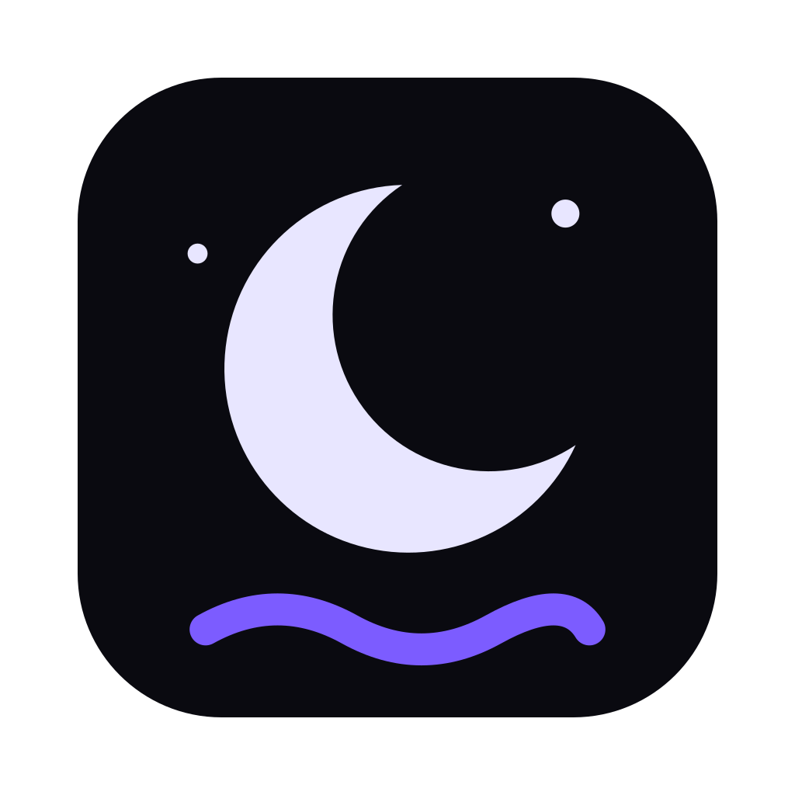
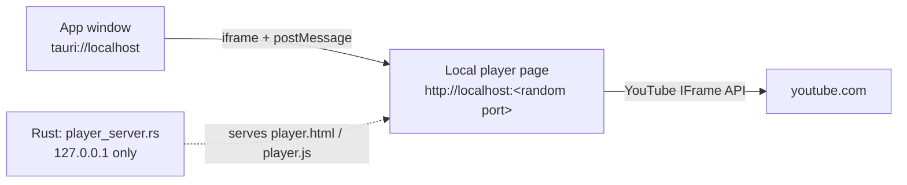

<div align="center">



# Driftwall

**Your desktop, alive.**

A native macOS wallpaper app for static and animated wallpapers.<br />
Power-aware, watermark-free by design, and light on memory.


</div>

---

## Features

| | |
|---|---|
| **Discover** | Browse free wallpapers and looping videos from Wallhaven, Pexels, Bing, NASA and Pixabay without leaving the app. Safe-for-work filtering is built in. |
| **Library** | Drag and drop your own images and videos. Filter, sort, multi-select, rename, and preview videos on hover. |
| **Live wallpapers** | Video wallpapers play behind your desktop icons, one lightweight window per display, with a watchdog that revives a frozen clip. |
| **Scenes** | Built-in animated scenes rendered on a canvas (Aurora, Nebula, Deep waves, Starfield, Drift, Night rain). No files, almost no storage. |
| **Rotation** | Pick a set of wallpapers and an interval, and Driftwall cycles through them. Missing files are skipped, never fatal. |
| **Music** | Paste a YouTube link or add audio files. The video card and the now-playing bar take on the colours of the video. |
| **Displays** | Choose what each monitor shows. |
| **Power-aware** | Pauses live wallpapers on battery, below a charge threshold, or in Low Power Mode. You set the policy. |
| **Menu-bar panel** | Quick controls for wallpapers and music without opening the main window. |

Driftwall has **no DRM and no watermark**.

## How YouTube music works

YouTube refuses to play inside an app whose pages are served from `tauri://localhost` and answers with
**error 153** (no valid referrer). Driftwall therefore starts a tiny web server that only listens on your
own machine and serves the player page from a real `http://localhost` address:



- It binds to `127.0.0.1` on a random free port, so nothing outside your Mac can reach it.
- It serves two static files and a health check, rejects every other `Host` header (DNS-rebinding protection),
  and sends a strict Content-Security-Policy.
- The app only accepts messages from that exact iframe and origin.
- If the server cannot start, the rest of Driftwall keeps working; only YouTube songs are unavailable.

The code lives in `app/src-tauri/src/player_server.rs`, `app/src-tauri/player/` and `app/src/lib/ytBridge.ts`.

## Getting started

### Requirements

- macOS 12 (Monterey) or newer
- [Node.js](https://nodejs.org) 22+ and [pnpm](https://pnpm.io)
- [Rust](https://rustup.rs) (stable) and the Xcode Command Line Tools: `xcode-select --install`

### Run it

```bash
git clone <your-fork-or-repo-url> driftwall
cd driftwall
pnpm install

cd app
pnpm tauri dev
```

### Build a `.dmg`

```bash
cd app
pnpm tauri build
```

The installer lands in `app/src-tauri/target/release/bundle/dmg/`.

> **Unsigned builds:** macOS Gatekeeper will say the app is from an "unidentified developer".
> Right-click the app and choose **Open**, or run
> `xattr -dr com.apple.quarantine /Applications/Driftwall.app`.

### Test

```bash
pnpm --filter driftwall-app test          # frontend unit tests (Vitest)
cd app/src-tauri && cargo test            # Rust unit tests, including the player server
```

## Project layout

| Path | Purpose |
|---|---|
| `app/` | The desktop app: React + TypeScript UI (`src/`) and Rust core (`src-tauri/`) |
| `app/src-tauri/src/` | Library store, Discover providers, downloads, wallpaper engine, power policy, local player server |
| `app/src-tauri/player/` | The YouTube player page served by the local server |
| `app/src/components/` | Views: Home, Discover, Library, Scenes, Music, Displays, Settings, menu-bar panel |
| `app/src/lib/` | Typed Tauri API wrapper, scenes, rotation, YouTube bridge, colour helpers |
| `contracts/` | JSON Schema and TypeScript types for the `.dwpkg` wallpaper package manifest |
| `design-system/` | The design system (`MASTER.md`) the UI follows |
| `docs/spec/` | Behavioural specs and gap analysis |
| `docs/progress/` | Per-phase progress reports |
| `backend/` | Reserved for an optional hosted service (not implemented yet) |

## Package format

`.dwpkg` is a Driftwall package: a manifest plus media. The manifest schema is in `contracts/`.

## Troubleshooting

**YouTube says "error 153" or the video does not play.**
Update to a build that includes the local player server. If it still fails, check that nothing blocks
loopback connections (some VPN and firewall tools do) and that you are online.

**No sound from YouTube songs.**
Check the volume slider in Music. Driftwall un-mutes and re-applies the volume whenever a video starts.

**Live wallpaper freezes.**
macOS can pause media in windows that sit behind the desktop. Driftwall resumes playback automatically and
reloads the clip if it stalls.

**Discover shows no videos.**
Some sources need your own free API key. Add it under **Settings → Sources**.

## Status

Driftwall is under active development. Progress reports for each phase are in `docs/progress/`.

## Clean-room statement

Driftwall is a clean-room implementation. It is informed by the *observed behaviour* of an existing wallpaper
app, never by its code, assets or branding. See `docs/spec/original-observations.md`.
